<p align="center">
  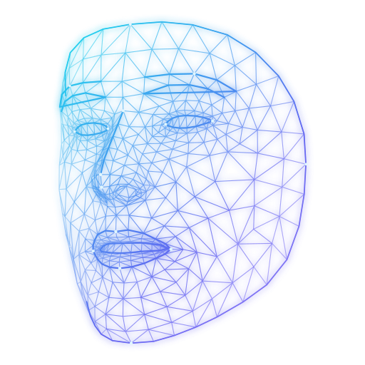
</p>

<h1 align="center">Wireface Desktop</h1>

<p align="center">
  <b>A face and a voice for the AI agent you already use.</b><br>
  Claude Code, OpenCode or Codex does the work in the background. A lip-synced 3D face floats over your windows,<br>
  talks with you, asks before it acts, and tells you what it did.
</p>

<p align="center">
  <a href="#download"><b>Download for Windows</b></a> &middot;
  <a href="https://wireface.dev">wireface.dev</a> &middot;
  <a href="#quick-start">Quick start</a> &middot;
  <a href="docs/guide.md">User guide</a> &middot;
  <a href="https://github.com/wireface/wireface-core">Wireface core</a>
</p>

<p align="center">
  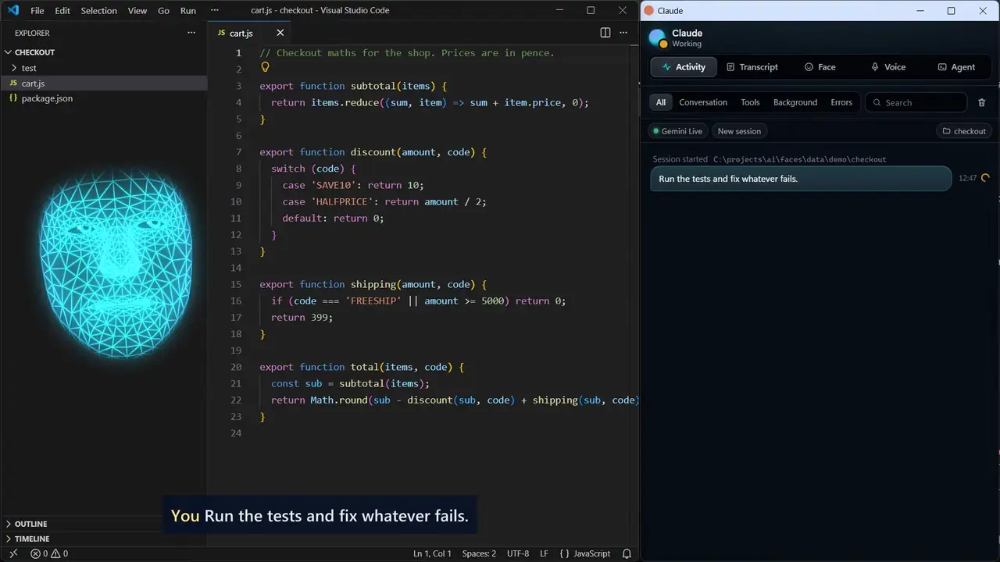
</p>
<p align="center"><sub>
  A real recording. Asked to "run the tests and fix whatever fails", Claude Code works in the background. The face
  asks before running each command and explains what it changed.
  <a href="https://wireface.dev/assets/demo/demo.mp4">Watch it with sound (47 s)</a>
</sub></p>

## Bring your own harness

Wireface isn't another agent. It's a new way to work with the one you already have.

Claude Code, OpenCode or Codex runs exactly as you've set it up, with your sign-in, model, skills, MCP servers,
`CLAUDE.md` or `AGENTS.md`, and permission rules. Wireface sits on top. It passes what you say to the agent as its
prompt, word for word, and turns everything the agent does into a face and a voice. There's no new harness to write
or trust, and nothing to set up again.

The panel's **Tools** tab has the agent's **MCP servers** (with whether each is connected, and problems first) and
its **Skills**, read from its own configuration, each with a switch that changes it the way the agent itself does.
Search them, see just what's installed, on, off or failing, and open any one for exactly what it runs and what its
switch changes. It also recommends some to install, saying what each needs and what Install will do: well-known MCP
servers, and skills made for a voice and a face, such as taking dictated notes or walking you through a task one step
at a time. See [the guide](docs/guide.md#tools-mcp-servers-and-skills).

<p align="center">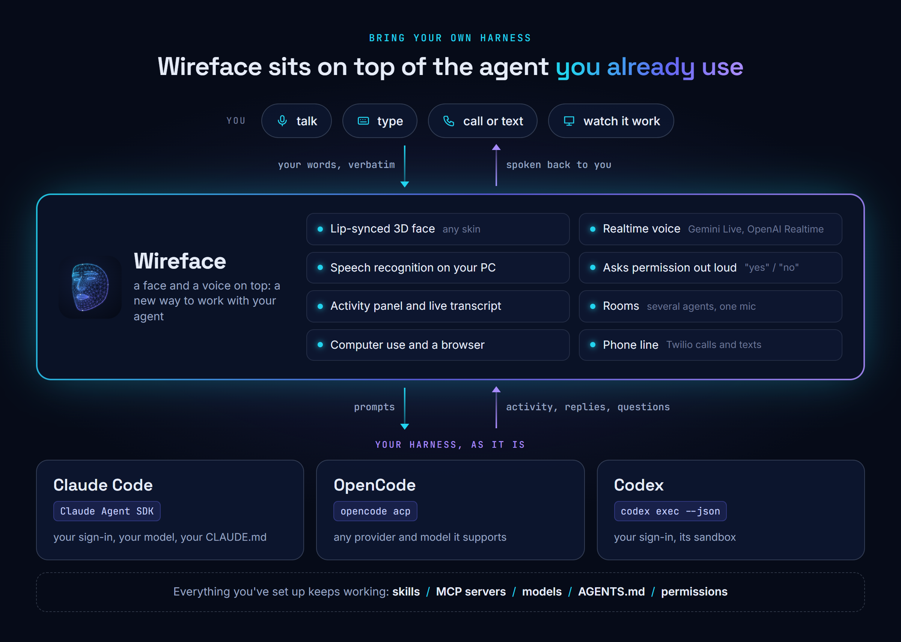</p>

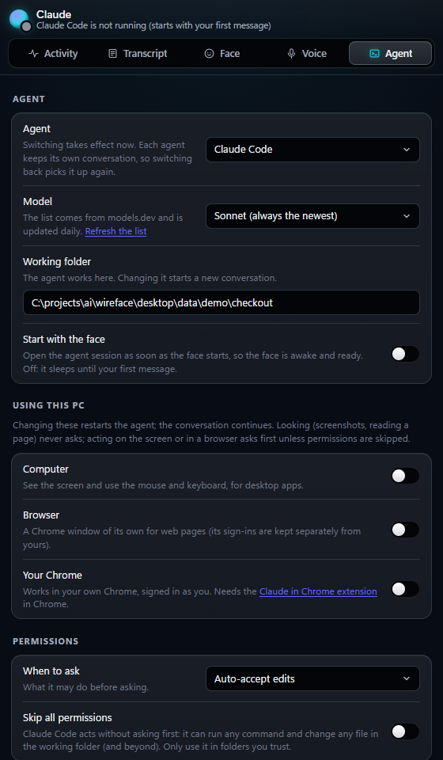

**Switch harness at any time** in the panel's Agent tab, along with the model and the folder it works in. Each
agent keeps its own conversation for each face, so you can switch and come back to it.

- **Claude Code**, through the Claude Agent SDK. It asks before it acts: Allow, Always or Deny, or just say "yes".
- **OpenCode**, through its Agent Client Protocol mode (`opencode acp`), with any provider and model OpenCode
  supports. It asks first too.
- **Codex**, through `codex exec --json`, resumed for each message. Its sandbox decides what it may do.

The model list for each harness comes from [models.dev](https://models.dev), and "Other..." takes any model name.

**Run several faces at once,** each with its own harness, folder, voice and look: `Wireface.cmd --face claude` in
one window and `Wireface.cmd --face codex` in another. Put them in a **room** and they share one microphone and
take turns answering you.

<br clear="right">

## Wear any face

<p align="center">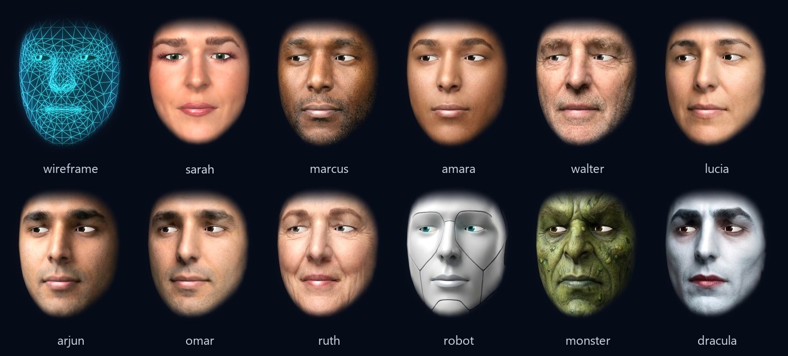</p>

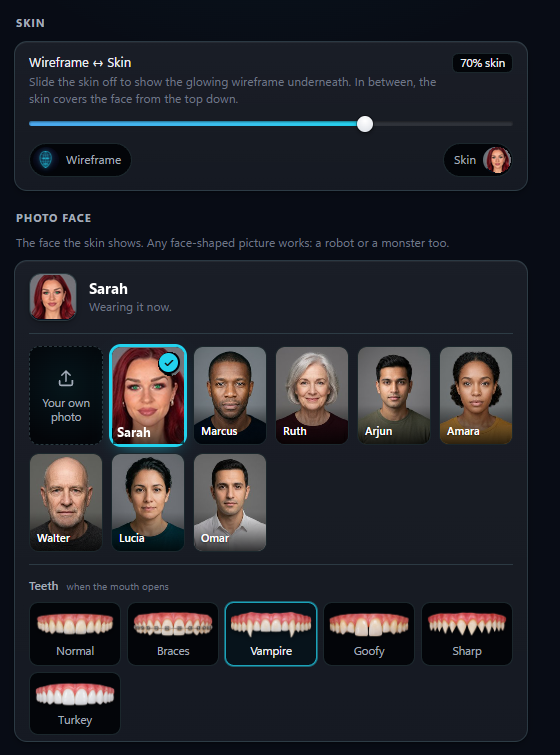

Eight portraits come with it, and it starts out wearing Sarah. To wear any other face, drop a photo of it on the face:
your PC finds the 468 face landmarks in the picture, and the photo becomes a 3D face that blinks, looks around, smiles
and talks. A robot, a monster or Dracula work too, as long as the picture is face-shaped.

Or just ask for one: "look like a pirate captain", "be Keanu Reeves". Claude Code has Wireface's portrait service at
wireface.dev draw the portrait (FLUX.2, no key needed) and puts it on as its own face in seconds.

The panel's Face tab has it all:

- **Skin**: a slider from the glowing wireframe to the full skin.
- **Photo face**: the eight portraits, or your own photo.
- **Teeth**: six styles.
- **Eye colour**: the photo's own, eight others, or any colour.
- **Colours**: presets or any colour for the glow, rim and background.
- **Look**: glow, mesh lines, surface, scanlines, points and a soft edge.
- **Motion**: whether the eyes follow the mouse, with head motion, expressiveness and lip sync under Advanced.
- **Expressions**: try each one.
- **Window**: a floating face, or a panel with captions; always on top. Scroll over the face to resize it.

<br clear="right">

Photo faces show **teeth** when the mouth opens:

<p align="center"></p>

### Or no skin at all

<p align="center">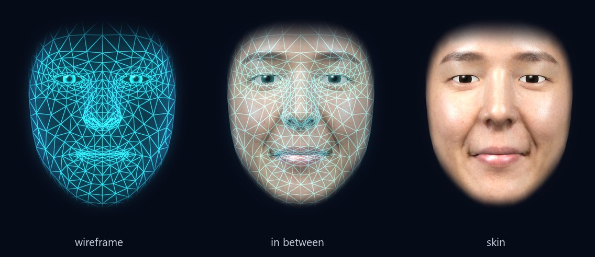</p>

Under every skin is a glowing **wireframe**. Slide between the two, all the way or part of the way: in between, the
whole face is a blend of both, the wireframe fading as the skin comes in. A new face sweeps on from the top down. The wireframe comes in
any colour, and glow, mesh lines, surface, scanlines and points all have sliders.

<p align="center">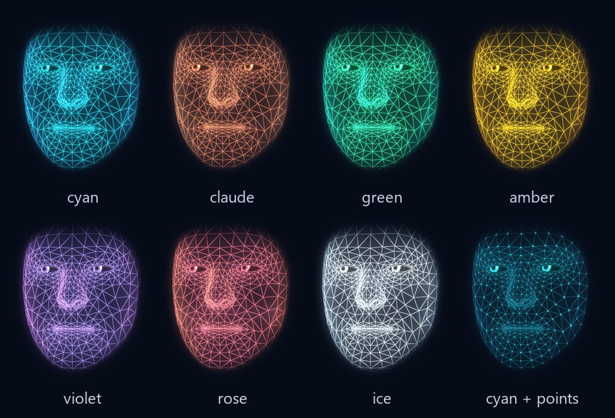</p>

### It shows how it feels

<p align="center">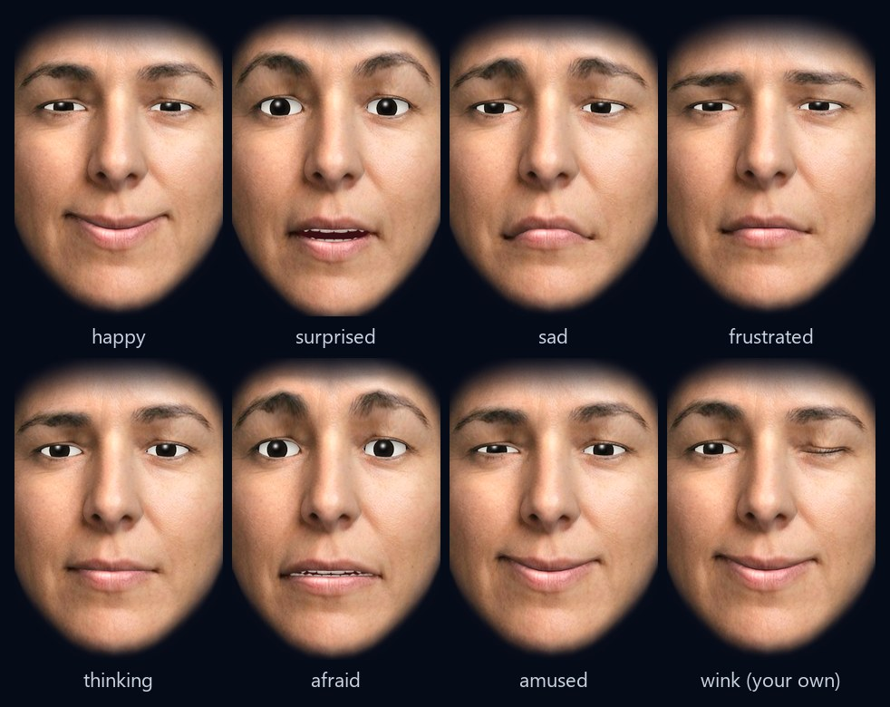</p>

It has eleven feelings, from happy to frustrated. Claude Code has a tool for them and uses it by itself ("my cat
died" gets a sad face, "I got the job" a happy one), and the face also takes cues from what it's saying. When the
agent is offline or stopped, the face falls asleep.

## See everything it does

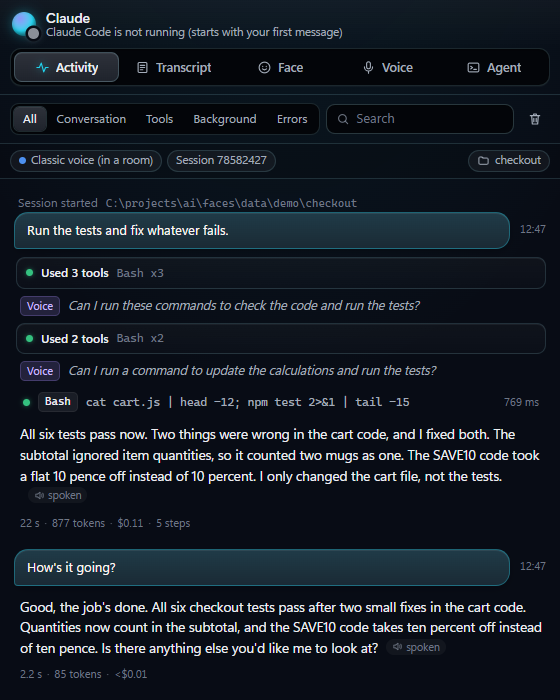

The **realtime voice** (Gemini Live or OpenAI Realtime) follows the agent's work and tells you about it as it
happens: replies, questions, problems and progress. Ask "how's it going?" mid-task and it answers at once. Your own
words go to the agent exactly as you said them. Speech recognition runs on your PC, so no audio leaves it.

The **activity panel** shows the whole session: every request, the tools used, what came back, time and cost. It
also shows what the voice actually said. Permission questions appear there with Allow and Deny buttons, and you can
also just say "yes" or "no". With Claude Code, its **Raw** view follows Claude Code's own session file live, with
every tool's complete output.

**Say its name** while it's talking ("Claude, wait...") and it stops within half a second and listens.

<br clear="right">

## And more

**"Go away" / "come back."** Say it, and the face glitches and burns away in sparks, then materialises again when
you call it back. The agent keeps working while the face is gone.

<p align="center">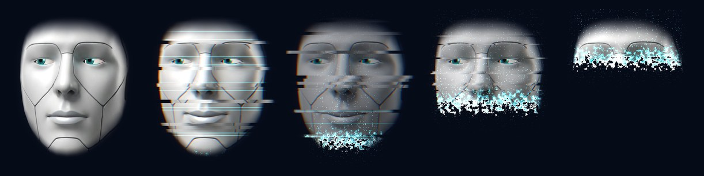</p>

**Rooms.** Several faces, each with a different agent, share one microphone and one conversation. One agent leads,
the others add a sentence each, and the lead wraps up. Say a name to choose who answers.

<p align="center">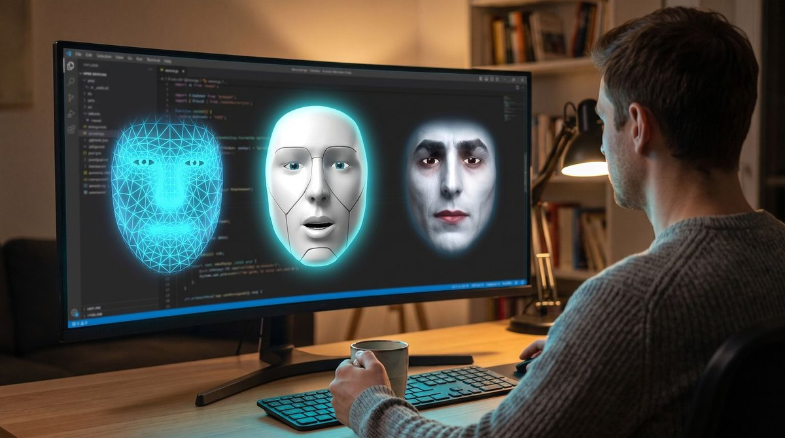</p>

**A phone line.** Give a face a Twilio number. A restricted receptionist agent answers calls and texts, takes
messages and books appointments, and has no access to your agent, files or computer. Your own agent can text and
call for you, but asks you first every time.

<p align="center">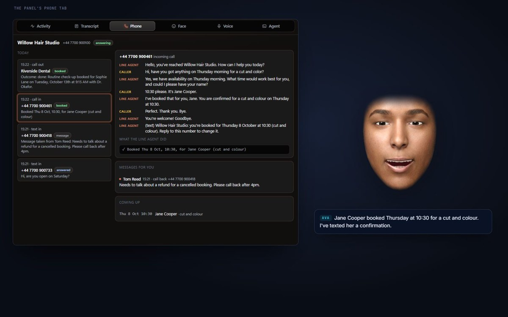</p>

**Using this PC.** Claude Code behind the face can take screenshots and use the mouse and keyboard, drive a Chrome
of its own, or work in yours with Claude in Chrome. Clicking and typing ask first, unless you skip permissions.

## Download

**[Wireface Desktop 0.1.3 for Windows](https://wireface.dev/download/WirefaceSetup-0.1.3.exe)** (64-bit, 133 MB),
from [Get started](https://wireface.dev/start/) on wireface.dev.

| | |
| --- | --- |
| Version | 0.1.3 |
| File | `WirefaceSetup-0.1.3.exe` |
| SHA-256 | [Published checksums](https://wireface.dev/download/SHA256SUMS.txt) |

Check the download before you run it. In PowerShell, print the checksum and compare it with the published checksums:

```powershell
(Get-FileHash .\WirefaceSetup-0.1.3.exe -Algorithm SHA256).Hash
```

The installer isn't code-signed yet, so Windows may say "Windows protected your PC". Once the hash matches, choose
**More info**, then **Run anyway**.

## Quick start

You need Windows (built and tested on Windows 11), and at least one agent installed and signed in:
[Claude Code](https://code.claude.com/docs), [OpenCode](https://opencode.ai) or [Codex](https://github.com/openai/codex).

**With the installer.** Run `WirefaceSetup-0.1.3.exe`, then start Wireface from the Start menu.
- **No administrator rights needed.** It installs for your user, in `%LOCALAPPDATA%\Programs\Wireface`.
- **Nothing else to install.** It brings its own Python, Electron and MediaPipe.
- **Speech models on first start.** They're about 650 MB, downloaded once in a window that shows the progress.
- **Uninstalling** (Settings > Apps) removes the app and the models, and keeps your settings in its `data` folder.

**From source.** You also need Python 3.11 or later, and Node.js:

```
git clone https://github.com/wireface/wireface-desktop wireface
cd wireface
Wireface.cmd
```

The first run installs everything into the folder:
- a Python venv;
- Electron, for the floating window;
- the speech models (about 650 MB, downloaded once).

Then right-click the face for settings, choose the folder your agent works in, turn on listening, and say hello.

To build the installer yourself, run `scripts\build-installer.ps1`. The version is in `wireface\version.py`.

For the realtime voice, add a Gemini or OpenAI key (`GEMINI_API_KEY` / `OPENAI_API_KEY`, or paste one into
Settings). Without a key, a voice that runs on your PC reads the replies instead.

**[The user guide](docs/guide.md)** covers everything else:
- [using it](docs/guide.md#using-it);
- [the realtime voice](docs/guide.md#the-realtime-voice);
- [choosing the agent](docs/guide.md#choosing-the-agent) and [permissions](docs/guide.md#permissions);
- [rooms](docs/guide.md#rooms-several-agents-one-conversation) and [the phone line](docs/guide.md#phone-calls-and-texts-twilio);
- [configuration](docs/guide.md#configuration) and [the code's layout](docs/guide.md#layout).

## The Wireface suite

- **Wireface Desktop** is this repository.
- **[Wireface core](https://github.com/wireface/wireface-core)** is the face engine on its own, for the browser,
  with an API, examples and a playground. It's for putting a talking face into your own app.
- **[wireface.dev](https://wireface.dev)** is the website.

Run the tests with `.venv\Scripts\python -m pytest tests`.

## Licence

Wireface Desktop is free for everyone, at home or at work, and its source is open to read, change and share. It may not
be sold, repackaged for sale, or made into a paid product or service:
[Apache License 2.0 with the Commons Clause](LICENSE.md). [NOTICE](NOTICE) lists the parts that come from other
projects, which keep their own licences.
